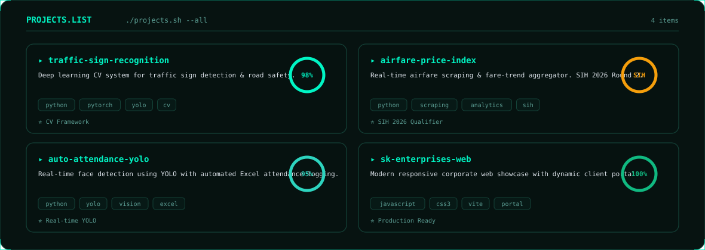
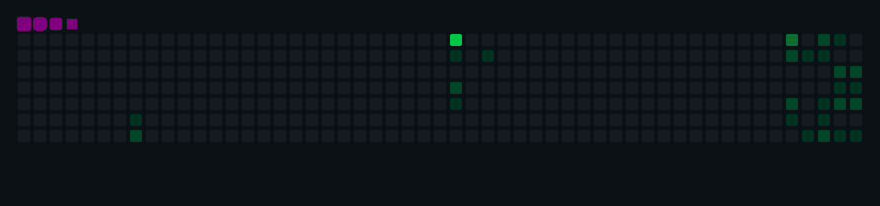

<div align="center">
  <picture>
    <source media="(prefers-color-scheme: dark)" srcset="./dark.svg">
    <source media="(prefers-color-scheme: light)" srcset="./light.svg">
    
  </picture>
</div>

<p align="center">
  <a href="https://komarev.com/ghpvc/?username=shubhamjena28&label=Profile%20Views&color=00f5c4&style=flat-square">
    
  </a>
  <a href="https://github.com/shubhamjena28/shubhamjena28/blob/main/Shubham_Jena_Resume.pdf">
    
  </a>
  <a href="https://leetcode.com/u/shubhamdebugger/">
    
  </a>
  <a href="https://linkedin.com/in/shubhamjena28">
    
  </a>
  <a href="mailto:jenashubham11@gmail.com">
    
  </a>
</p>

---

### ⚡ Language Stack

<div align="center">
  
</div>

---

### 🛠️ Work

<div align="center">
  
</div>

---

### 📄 Resume

Click below to view or download my complete official resume directly on GitHub:

<p align="left">
  <a href="https://github.com/shubhamjena28/shubhamjena28/blob/main/Shubham_Jena_Resume.pdf">
    
  </a>
  &nbsp;&nbsp;
  <a href="https://raw.githubusercontent.com/shubhamjena28/shubhamjena28/main/Shubham_Jena_Resume.pdf" download>
    
  </a>
</p>

```text
┌─────────────────┬────────────────────────────────────────────────────────────┐
│ Section         │ Highlights & Credentials                                   │
├─────────────────┼────────────────────────────────────────────────────────────┤
│ Education       │ B.Tech in Computer Science | UPES Dehradun (CGPA: 8.7/10)   │
│                 │ City Montessori School | Class X: 97% | Class XII: 93%     │
│ Hackathons      │ Smart India Hackathon 2026 (SIH 2026) Round 2 Qualifier    │
│ Experience      │ Summer Trainee @ Founder Code Technology (2-month Trainee) │
│ Leadership      │ PR & Outreach @ Cultural Committee of UPES (RRR)           │
│                 │ Event Coordinator @ Cyber Sentinel (UPES Student Chapter) │
└─────────────────┴────────────────────────────────────────────────────────────┘
```

---

### 🐍 Contribution Activity Graph

<picture>
  <source media="(prefers-color-scheme: dark)" srcset="https://raw.githubusercontent.com/shubhamjena28/shubhamjena28/output/github-contribution-grid-snake-dark.gif">
  <source media="(prefers-color-scheme: light)" srcset="https://raw.githubusercontent.com/shubhamjena28/shubhamjena28/output/github-contribution-grid-snake.gif">
  
</picture>

---

### 📬 Connect & Collaborate

<p align="left">
  <a href="https://linkedin.com/in/shubhamjena28" target="_blank">
    
  </a>
  <a href="https://leetcode.com/u/shubhamdebugger/" target="_blank">
    
  </a>
  <a href="https://instagram.com/jenastalks" target="_blank">
    
  </a>
  <a href="mailto:jenashubham11@gmail.com" target="_blank">
    
  </a>
  <a href="https://github.com/shubhamjena28/shubhamjena28/blob/main/Shubham_Jena_Resume.pdf" target="_blank">
    
  </a>
</p>
