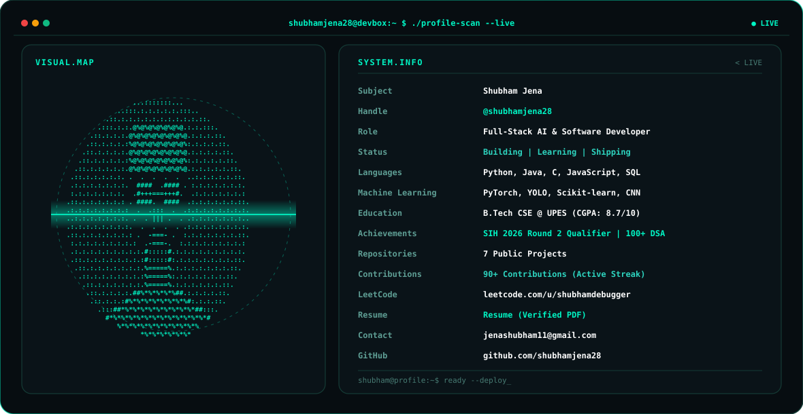

<div align="center">
  <picture>
    <source media="(prefers-color-scheme: dark)" srcset="./dark.svg">
    <source media="(prefers-color-scheme: light)" srcset="./light.svg">
    
  </picture>
</div>

<p align="center">
  <a href="https://komarev.com/ghpvc/?username=shubhamjena28&label=Profile%20Views&color=22d3ee&style=flat-square">
    
  </a>
  <a href="https://leetcode.com/u/shubhamdebugger/">
    
  </a>
  <a href="https://linkedin.com/in/shubhamjena28">
    
  </a>
  <a href="mailto:jenashubham11@gmail.com">
    
  </a>
  <a href="https://resume-myself.tiiny.site">
    
  </a>
</p>

---

### 🚀 Overview & Focus

I am a **Computer Science & Engineering Student**, **Machine Learning Explorer**, and **Algorithmic Problem Solver**. Passionate about designing deep learning systems, computer vision models, and building software that bridges engineering logic with practical applications.

- 🔭 **Current Focus:** Deep Learning, Object Detection & Classification, Computer Vision pipelines.
- 💡 **Core Strengths:** C, Python, Java, SQL, PyTorch, Scikit-Learn, and Data Structures & Algorithms.
- 🎯 **Problem Solving:** Actively practicing algorithmic problem solving on [LeetCode (@shubhamdebugger)](https://leetcode.com/u/shubhamdebugger/).
- 📄 **Interactive Resume:** Check out my verified experience and credentials on [resume-myself.tiiny.site](https://resume-myself.tiiny.site).
- ⚡ **Fun Fact:** I love playing cricket and watching agentic technology movies.

---

### 🛠️ Engineering Tech Stack

```text
┌─────────────────┬────────────────────────────────────────────────────────────┐
│ Category        │ Technologies & Tools                                       │
├─────────────────┼────────────────────────────────────────────────────────────┤
│ Languages       │ Python, Java, C, SQL, JavaScript                           │
│ ML & AI Vision  │ PyTorch, YOLOv8, ResNet, Faster R-CNN, Scikit-Learn, Pandas│
│ Databases       │ MySQL, MongoDB                                             │
│ Tools & Web     │ Streamlit, Git, GitHub, Jupyter Notebooks, Linux Shell     │
└─────────────────┴────────────────────────────────────────────────────────────┘
```

<p align="left">
  &nbsp;&nbsp;
  &nbsp;&nbsp;
  &nbsp;&nbsp;
  &nbsp;&nbsp;
  &nbsp;&nbsp;
  &nbsp;&nbsp;
  &nbsp;&nbsp;
  
</p>

---

### 💻 Featured Projects

#### 1. [Traffic Sign Recognition & Road Safety Monitoring System](https://github.com/shubhamjena28/traffic-sign-recognition-road-safety)
> **Technologies:** Python, PyTorch, YOLOv8, ResNet-18, Faster R-CNN, Streamlit GUI, Java Integration
- Robust deep learning computer vision framework for detecting, classifying, and monitoring traffic signs in real-time.
- Features multi-model pipelines, detailed model cards, hyperparameter tuning configs, and an interactive Streamlit UI.

#### 2. SK Enterprises Corporate Web Showcase
> **Technologies:** Modern Web Standards, JavaScript, CSS3 Responsive Grid
- Fast, accessible, production-grade business portal featuring dynamic product showcases, enterprise branding, and modular structure.

#### 3. [Profile Analyser & ML Workflows](https://github.com/shubhamjena28)
> **Technologies:** Python, JavaScript, Jupyter Notebooks, Scikit-Learn
- Analytical developer tooling and predictive ML pipelines covering linear regression, multi-class classification, and data analysis.

---

### 📊 GitHub Activity & Analytics

<p align="center">
  
  &nbsp;&nbsp;
  
</p>

---

### 🐍 Contribution Activity Graph

<picture>
  <source media="(prefers-color-scheme: dark)" srcset="https://raw.githubusercontent.com/shubhamjena28/shubhamjena28/output/github-contribution-grid-snake-dark.gif">
  <source media="(prefers-color-scheme: light)" srcset="https://raw.githubusercontent.com/shubhamjena28/shubhamjena28/output/github-contribution-grid-snake.gif">
  
</picture>

---

### 📬 Connect & Collaborate

<p align="left">
  <a href="https://linkedin.com/in/shubhamjena28" target="_blank">
    
  </a>
  <a href="https://leetcode.com/u/shubhamdebugger/" target="_blank">
    
  </a>
  <a href="https://instagram.com/jenastalks" target="_blank">
    
  </a>
  <a href="mailto:jenashubham11@gmail.com" target="_blank">
    
  </a>
</p>
